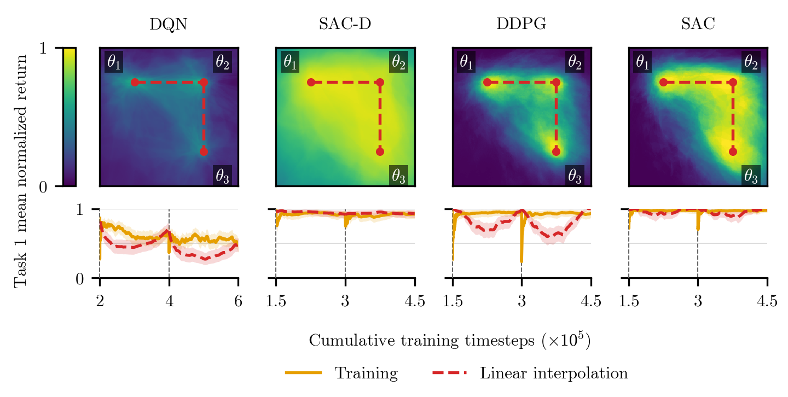

# Stability Gap in Deep Reinforcement Learning



**Navigate:** [Benchmark](#benchmark) · [Experiments](#experiments-and-reproduction) · [Joint incremental learning](#joint-incremental-learning) · [Foundation](#foundation)

## Benchmark

This project studies the stability gap when a reinforcement learning agent moves between tasks. For each run, the benchmark creates three tasks from either CartPole or Inverted Pendulum. Each task applies its own seeded, orthogonal matrix to the environment's four-dimensional observation: `observation = matrix @ original_observation`. The environment's actions, transitions, and rewards stay the same, while the agent sees a different observation representation at each task switch.

The matrices are reproducible from the run seed. For task `i`, the matrix seed is `3 * seed + i`. A Gaussian matrix is decomposed with QR, and the diagonal signs of `R` resolve the sign ambiguity in `Q`. The relevant function from the [benchmark implementation](transformation/benchmarks/transformed_env_benchmark.py) is:

```python
def random_orthogonal(seed: int, size: int) -> np.ndarray:
    rng = np.random.default_rng(seed)
    m = rng.normal(size=(size, size))

    q, r = np.linalg.qr(m)

    signs = np.sign(np.diag(r))
    q = q * signs

    return q.astype(np.float64)
```

An optional one-hot task identifier is appended **after** the observation transform. Training and evaluation use the same matrices but separate environment seeds (`seed` and `seed + 1`). CartPole episodes are capped at 500 steps and Inverted Pendulum episodes at 1,000. See the [observation wrappers](transformation/benchmarks/wrappers.py) and [environment selection](transformation/main.py) for the full setup.

## Experiments and reproduction

Experiment settings live in [`dispatch/experiments/`](dispatch/experiments/). The main joint incremental runs are in [`joint_incremental/`](dispatch/experiments/joint_incremental/); related controls and exploration studies are in [`joint_incremental_control/`](dispatch/experiments/joint_incremental_control/) and [`exploration/`](dispatch/experiments/exploration/). Training starts in [`transformation/main.py`](transformation/main.py).

From the repository root, install the locked dependencies with [uv](https://docs.astral.sh/uv/), then run a single local example:

```bash
uv sync
uv run python -m transformation.main --env cartpole --algorithm dqn \
  --method joint_incremental --mode continual --encode_task \
  --seed 0 --project stability-gap-demo
```

The training script logs runs to Weights & Biases. For the full configured runs, [`dispatch/dispatch_yaml.py`](dispatch/dispatch_yaml.py) expands YAML settings and seed sweeps into Slurm jobs. Preview a configuration before submitting it:

```bash
uv run python dispatch/dispatch_yaml.py --dry joint_incremental/dqn.yaml
uv run python dispatch/dispatch_yaml.py joint_incremental/dqn.yaml
```

The Slurm launcher, [`dispatch/dispatch.sh`](dispatch/dispatch.sh), assumes the checkout is at `/scratch/$USER/stability-gap-drl`; adjust that path for your cluster. Inverted Pendulum runs also require a working MuJoCo installation.

## Joint incremental learning

The shared [off-policy joint incremental implementation](stable_baselines3/continual/off_policy_joint_incremental.py) keeps task-specific replay buffers and trains across tasks seen so far. Algorithm implementations are available for [DQN](stable_baselines3/dqn/dqn_joint_icremental.py), [SAC-D](stable_baselines3/sacd/sacd_joint_incremental.py), [SAC](stable_baselines3/sac/sac_joint_incremental.py), and [DDPG](stable_baselines3/ddpg/ddpg_joint_incremental.py). The experiment configs control whether optimizer state and replay buffers reset at task changes.

## Foundation

The agents build on the included, extended [`stable_baselines3/`](stable_baselines3/) codebase. For the underlying reinforcement learning library, see [Stable-Baselines3](https://github.com/DLR-RM/stable-baselines3).
